## 👋 Hi, I'm Rithik

I'm a **Data & AI Engineer** in Boston. I like the place where data engineering meets AI: reliable pipelines underneath, and LLM applications on top that people actually use.

- 🤖 Building **AI agents**, **RAG** pipelines and **text-to-SQL** tools, and caring about **evals** and **guardrails** as much as the prompt
- 🧊 Into **lakehouses**: Apache Spark, Apache Iceberg and warehouses like BigQuery and Snowflake
- 🔷 Fan of **ontology-driven** data modelling with Palantir Foundry
- 🌱 Currently putting more of my learning into public repos here, so watch this space
- 📫 **19rithik@gmail.com** · [portfolio](https://rithikchalla.github.io/portfolio/) · [LinkedIn](https://www.linkedin.com/in/rithikreddychalla)

## 🧰 Toolbox

**AI & LLM**

**Data engineering**

-101113?style=flat-square&logo=palantir&logoColor=white)

**Cloud & DevOps**

-0078D4?style=flat-square&logo=microsoftazure&logoColor=white)

**Languages, frameworks & BI**

## 🏅 Certification

**Google Cloud Certified Professional Data Engineer** (January 2025): designing, building, securing and operating data systems on Google Cloud.

## 🎓 Education

- **MS, Data Analytics Engineering**, Northeastern University, Boston
- **BE, Computer Science**, Osmania University (MVSR Engineering College), Hyderabad

## 🚀 Public projects

| Project | What it is | Stack |
| --- | --- | --- |
| [**Coding Agent in Go**](https://github.com/rithikchalla/codecrafters-claude-code-go) | My own Claude Code-style coding assistant: an agent loop over an LLM with tool calling | Go · LLM · Agents |
| [**Finance ETL Process**](https://github.com/smurffers/finance-ETL-Process) | Pulls financial statements of public companies from SEC EDGAR into a de-normalised, queryable data asset | Python · ETL · Testing |
| [**dbt Transformation Project**](https://github.com/smurffers/dbt-dibi-project) | Macros, type casting and nested, repeated tables for BI-ready data | dbt · SQL · BigQuery |
| [**Fakeddit News Detection**](https://github.com/rithikchalla/fakeddit-news-detection) | Fake-news detection on a 1M+ sample dataset: a from-scratch neural net vs a fine-tuned BERT | Python · NLP · BERT |

More public projects on AI agents and lakehouses are on the way.

## 📊 GitHub stats

  
  

**Say hi** → [19rithik@gmail.com](mailto:19rithik@gmail.com) · [rithikchalla.github.io/portfolio](https://rithikchalla.github.io/portfolio/)

